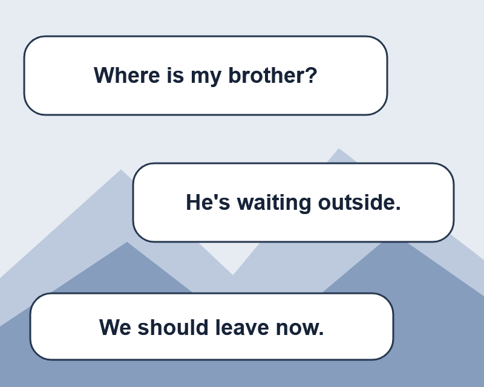
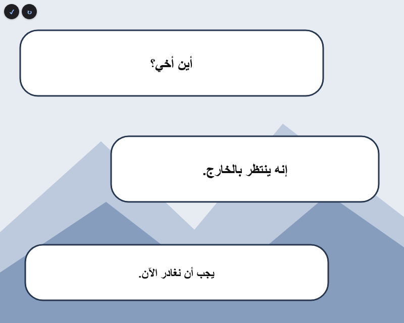
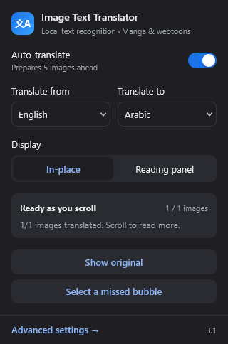
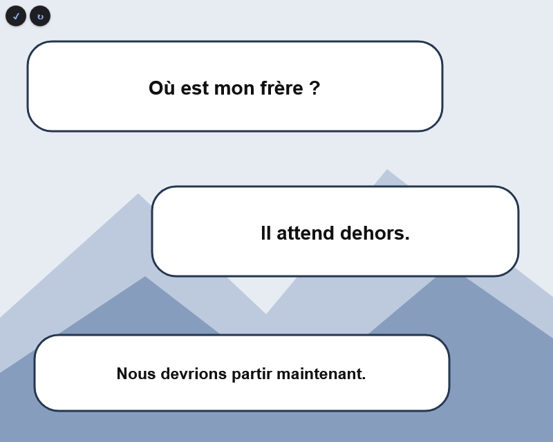

# Manga Translator

Manga Translator is a Firefox extension for reading manga and webtoons in another language. It finds text inside images and places the translation over the speech bubbles. You can also switch to a reading panel if you prefer a plain text view.

English, French, and Arabic text recognition works out of the box. Japanese, Korean, Chinese, and a multilingual mode are available too, with language files downloaded on first use. Translation requires an internet connection.

## Screenshots

These screenshots show the extension running in Firefox on an original sample page, including a bubble corrected with the selection tool. The translations come from the extension's OCR and translation service.

| Original text | Arabic translation |
| --- | --- |
|  |  |

The popup lets you choose languages, switch the display mode, or select a missed bubble.



<details>
<summary>See the French translation</summary>



</details>

## Install in Firefox

You'll need Firefox 115 or newer.

1. Download this repository using **Code → Download ZIP**, then extract it. You can also clone it with Git.
2. Open `about:debugging#/runtime/this-firefox` in Firefox.
3. Click **Load Temporary Add-on** and select `manifest.json` from the extracted folder.
4. Open a manga chapter, or refresh one you already have open.
5. Click the extension icon. Set **Translate from** to the language printed in the images, choose **Translate to**, and turn on **Auto-translate**.

For an English chapter you want to read in Arabic, choose English as the source and Arabic as the target. Choosing a specific source language is usually faster and more reliable than the multilingual option.

Firefox removes temporary add-ons when it closes. Load the extension again after restarting. A permanent installation requires a package signed by Mozilla.

## While you're reading

The extension translates visible images first, then prepares the next five images while you read. You can sit on the same page and let it catch up. If you jump ahead during a fight scene, the queue moves to your new position after the current image finishes processing.

The buffer follows your reading position. It stops after those five images until you scroll farther. Images must already exist in the page; the extension picks up newly added chapter images as they appear.

- **In-place** puts translations over each detected speech region. Hover over the text to peek at the original.
- **Reading panel** shows the image's translations in a text card, with the original text available underneath.
- **Show original** hides the translations. The round buttons on an image let you toggle that image or read it again.
- **Select a missed bubble** lets you drag around text that automatic detection missed. Press Escape to cancel.

If an image request fails, the popup shows the error and offers **Retry failed images**. Advanced settings has controls for text size, colors, translation services, and automatic translation on new pages.

## Recognition and translation

Text recognition runs in your browser using Tesseract. English, French, and Arabic models are included in the repository. Other language models download from `tessdata.projectnaptha.com` when needed.

Image processing stays in the browser. The recognized text goes to the translation service you choose: Google Translate, MyMemory, or LibreTranslate. You can use your own LibreTranslate server and API key. Preferences and cached translations are stored by the extension.

The default Google Translate endpoint is unofficial and may stop working or limit requests. MyMemory has usage quotas, and LibreTranslate services may require an API key. The extension reports service errors rather than switching providers automatically.

## What can still go wrong

Small lettering, unusual fonts, rotated text, sound effects, and busy backgrounds can confuse the OCR. Text split across separate image files can also lose context. Selecting a missed bubble often helps, but recognition won't always match Google Lens. Vertical Japanese text recognition is experimental.

The extension reads image elements. Readers that draw pages inside a canvas, video, or CSS background need a different approach. Cropped or transformed images can also affect translation placement.

## Build a package

With Python 3 and Node.js installed, run:

```sh
npm run package
```

This creates `dist/manga-translator-3.1.0.xpi` with the extension code and OCR files. The package still needs Mozilla signing for permanent Firefox installation. You can load `manifest.json` directly while developing; the extension doesn't need an npm install.

## License

The extension uses the [MIT license](LICENSE). Bundled Tesseract files and language data keep their upstream licenses; see [libs/LICENSE-tesseract.txt](libs/LICENSE-tesseract.txt) and [libs/README.md](libs/README.md).
